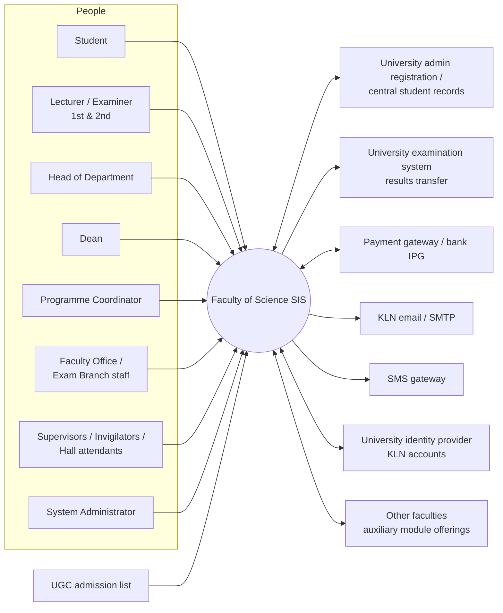
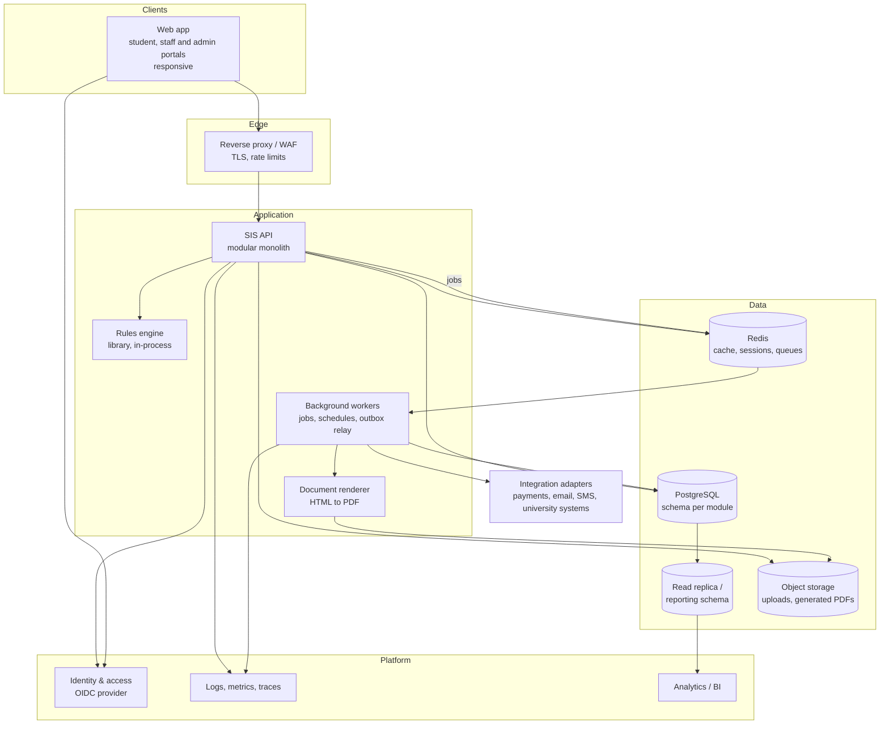
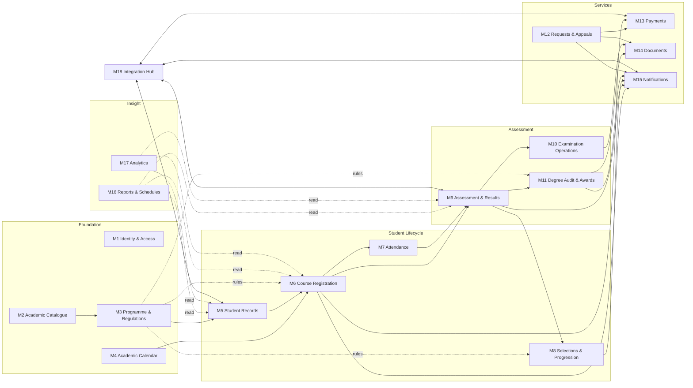
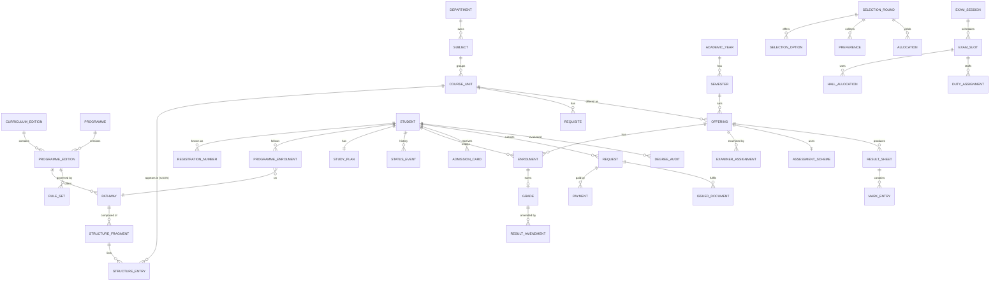
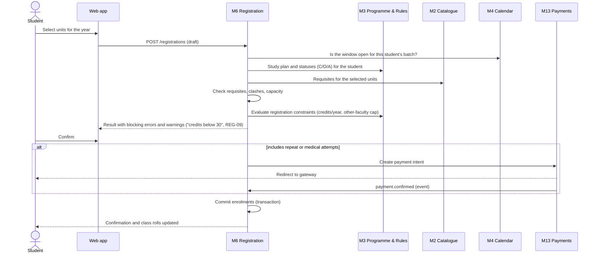
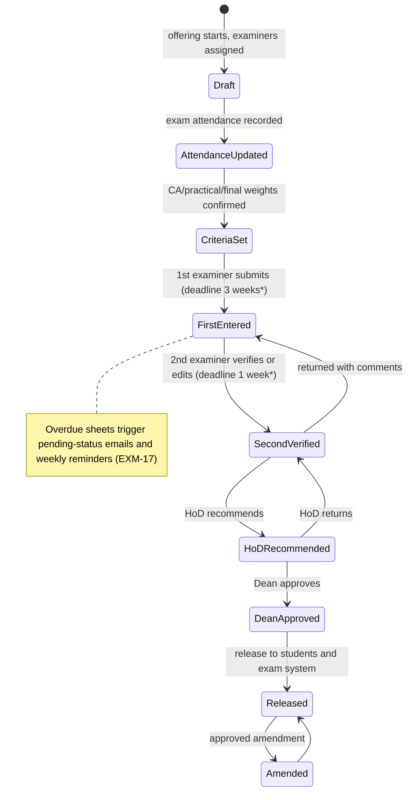
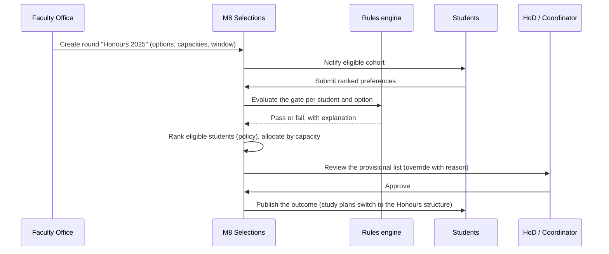
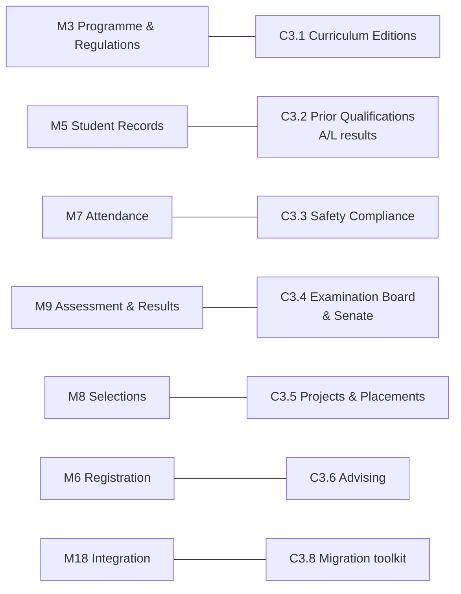
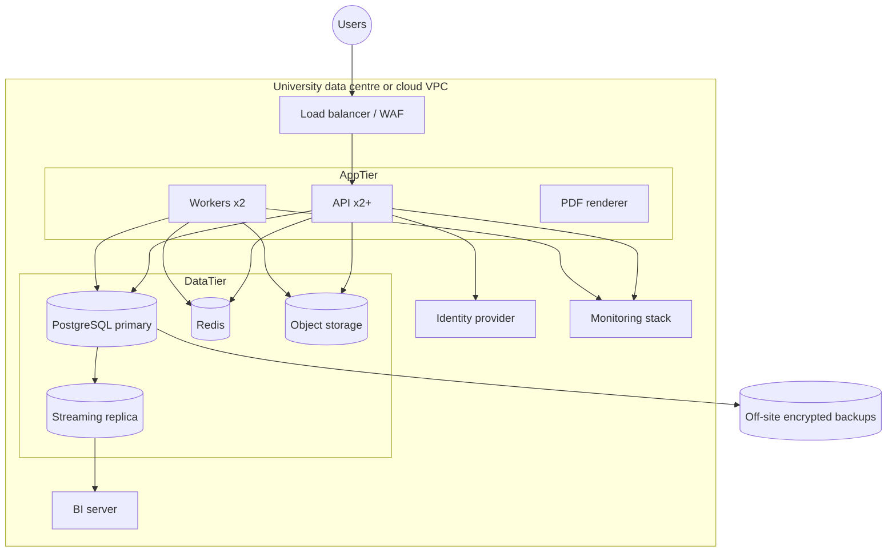

# Faculty of Science SIS: System Architecture

**Scope:** a web-based Student Information System (SIS) to manage the academic activities of the Faculty of Science, University of Kelaniya.

**Status:** Draft v0.2. v0.1 is the baseline architecture (Part B). The refinements from the gap analysis are in Part C.

---

## Contents

- [Part A: What the system has to model](#part-a-what-the-system-has-to-model)
  - [A1. Requirement catalogue](#a1-requirement-catalogue)
  - [A2. How the degree programmes differ](#a2-how-the-degree-programmes-differ)
  - [A3. Design drivers](#a3-design-drivers)
- [Part B: Baseline architecture (v0.1)](#part-b-baseline-architecture-v01)
  - [B1. Architectural style](#b1-architectural-style)
  - [B2. System context](#b2-system-context)
  - [B3. Containers](#b3-containers)
  - [B4. Modules (components)](#b4-modules-components)
  - [B5. Cross-cutting components](#b5-cross-cutting-components)
  - [B6. Core data model](#b6-core-data-model)
  - [B7. Key flows](#b7-key-flows)
  - [B8. Requirement traceability](#b8-requirement-traceability)
- [Part C: Gap analysis and refined architecture (v0.2)](#part-c-gap-analysis-and-refined-architecture-v02)
  - [C1. Gaps found](#c1-gaps-found)
  - [C2. Requirements that conflict with the handbook](#c2-requirements-that-conflict-with-the-handbook)
  - [C3. Architecture changes](#c3-architecture-changes)
  - [C4. Non-functional requirements](#c4-non-functional-requirements)
  - [C5. Deployment](#c5-deployment)
  - [C6. Technology choices](#c6-technology-choices)
  - [C7. Delivery phases](#c7-delivery-phases)
  - [C8. Open questions](#c8-open-questions)

---

# Part A: What the system has to model

## A1. Requirement catalogue

The *General Requirements* sheet has no IDs, so this document assigns them. The IDs follow the sheet's six groups and keep its numbering.

| ID | Requirement (from the template) |
|---|---|
| **REG: Registration** | |
| REG-01 | Students register for course units for the academic year |
| REG-02 | Students register for Semester I units (Biological Science stream) |
| REG-03 | Students add or drop course units, with prerequisite checks |
| REG-04 | Students register for repeat or medical examinations, with online payment |
| REG-05 | Course modules can be changed before and during the semester, and affected students moved to the changed modules |
| REG-06 | Student personal details are held and editable: name, gender, registered date, degree validity date, mobile, land line, personal and KLN email, valid academic year |
| REG-07 | Detect clashes between modules |
| REG-08 | Move a student's results to a new registration number when the number changes |
| REG-09 | Alert the student when their credits are not enough, during registration and add/drop |
| REG-10 | Show repeat and medical modules separately in the student interface, with the credits still needed |
| REG-11 | Remove students who have upgraded or cancelled their registration |
| REG-12 | Suspend the academic registration of students under disciplinary inquiry |
| REG-13 | Notify students to submit an appeal to sit exams once five years have passed |
| REG-14 | Student interface: login, view results, view final results, reset password, exam admission |
| REG-15 | Show modules from other faculties separately (including BSSS and BECS) |
| REG-16 | Defer a student's modules to the next academic year |
| REG-17 | Generate the class roll |
| REG-18 | Record class attendance |
| **REQ: Student requests and appeals** | |
| REQ-01 | Students submit exam deferment appeals and other appeals through the SIS |
| REQ-02 | Students obtain a Medium of Instruction letter |
| REQ-03 | Students obtain an interim results sheet, detailed results sheet or transcript, with online payment |
| REQ-04 | Prepare the final results sheet, and download or print it |
| REQ-05 | Students request an early exit |
| REQ-06 | Students request a fallback exit |
| **EXM: Examination** | |
| EXM-01 | Repeat-student marks are automatically included as C (see [C2](#c2-requirements-that-conflict-with-the-handbook)) |
| EXM-02 | Hold the examiner list in the SIS and notify examiners of the results-release deadline |
| EXM-03 | Summarise exam dates against results-release dates |
| EXM-04 | Summarise modules whose results are unreleased, by department and by degree programme |
| EXM-05 | Staff upload CA, practical and final marks. Results are released after the HoD recommends them and the Dean approves, and students see them in real time. Release procedure: update attendance → set mark criteria → first examiner enters marks (3 weeks) → reminder → second examiner verifies (1 week) → reminder → HoD → Dean → release |
| EXM-06 | Hold exam admission for students who have not completed University administrative registration |
| EXM-07 | Allocate exam halls by student count |
| EXM-08 | Prepare duty lists for supervisors, invigilators and hall attendants |
| EXM-09 | Move a student's results from one student number to another (same as REG-08) |
| EXM-10 | Decide whether degree requirements are met, using the handbook criteria, GPA and class, and show the outcome to the student |
| EXM-11 | Download and print the final pass list (name, class, GPA) for each degree |
| EXM-12 | Withhold a student's results and block their module registration |
| EXM-13 | Produce the exam attendance sheet, mark sheet, first and second examiner mark sheets and moderation sheet, with exam date, time and venue |
| EXM-14 | Prepare the exam timetable and show it to staff |
| EXM-15 | Students view, download and print their exam admission |
| EXM-16 | Update exam attendance after the exam |
| EXM-17 | Send weekly reminders to examiners who miss the results deadline |
| EXM-18 | Upload module results |
| **SCH: Schedules and summaries** | |
| SCH-01 | Registered list for each module: proper and repeat students, together or separately |
| SCH-02 | Registered list for each module, with each student's pathway |
| SCH-03 | Registration numbers of students with clashing modules |
| SCH-04 | Per-student record for each academic year: modules, repeat and medical modules, GPA, credit count |
| SCH-05 | Counts of proper and repeat registrations in one summary |
| SCH-06 | Module registrations with student counts, by year of study |
| SCH-07 | Students in each year of study, with name, registration number and gender |
| SCH-08 | Students and counts by pathway and by degree |
| **SEL: Selections** | |
| SEL-01 | Pathway selection: Physical Science stream |
| SEL-02 | Pathway selection: Biological Science stream |
| SEL-03 | Honours selection: Physical, Biological, BECS, ENCM |
| SEL-04 | Prepare, publish and download the Dean's list; students can request a Dean's list letter |
| SEL-05 | Pathway selection: Management and Information Technology |
| SEL-06 | Pathway selection: Information Technology |
| **ANA: Data analytics** | |
| ANA-01 | Descriptive: results summary per module, attendance, continuous assessment |
| ANA-02 | Diagnostic: GPA calculations, results comparison, pass rates |
| ANA-03 | Predictive: five-year results trends and predictions; enrolment predictions |

These items from the per-programme sheet are **not** in the general list:

| ID | Requirement | Source |
|---|---|---|
| PS-01 | Aptitude test and foundation course for all selected BSSS students | BSSS, Y1 S1 |
| PS-02 | Manage registration schedules: open and close dates, add/drop period | BSSS, every year |
| PS-03 | Course changes allowed only in the first two weeks | BSSS (handbook §1.7 applies to all) |
| PS-04 | Assign first and second examiners when the course starts | BSSS (EXM-05 implies for all) |
| PS-05 | Progression requires GPA > 2.0, considering new, repeat and missed batches | BSSS, Y3 |
| PS-06 | Project coordinator publishes the supervisor list; students give 3 preferences; coordinator allocates by GPA; students are notified | BSSS, Y4 |
| PS-07 | Generate transcript | BSSS, Y4 |
| PS-08 | Selection between BSc Hons IT and BSc Hons MIT, and MIT specialisation (BSE, OSCM, IS) | MIT/IT |

## A2. How the degree programmes differ

The programmes vary along the dimensions below. Each one becomes a design constraint (DC) in A3.

### A2.1 Programme families

| Family | Programmes | Entry | Selection points | Structure | Exits |
|---|---|---|---|---|---|
| **Stream BSc** (SLQF 5) | BSc via Biological Science (8 combinations) and Physical Science (10 combinations) | UGC to stream (221 / 362 places) | **BS:** subjects chosen at start of Y1 S2, ranked on S1 results; caps BIOC 60, COST 25, MIBI 60. **PS:** subjects chosen at start of Y1; caps COSC 150, COST 25, ELEC 40, STAT 125 | Combination of 2–3 subjects. A unit is C, O or A depending on the combination | Award after 3 years |
| **Fixed BSc** | BSc ENCM, BSc PE (2 paths) | UGC direct (109 / 76 places) | PE path | Fixed per path | Award after 3 years |
| **Merit Honours** (SLQF 6) | 14 subjects / 15 rule sets | Applied for at end of Y2 from Stream BSc, ENCM or PE | End of Y2: common gate plus subject-specific grade rules; department caps | Years 1–2 from the combination; Years 3–4 from the Honours column, which depends on the stream and, for Physics, on whether the student took Electronics | Revert to BSc during Y4, or within 14 days of Y4 results |
| **Direct Honours, fixed** | APCH, BSSS | UGC direct | None. BSSS has a foundation programme and aptitude test | Fixed. BSSS has Level 0 foundation units | None stated |
| **Direct Honours, branching** | MIT/IT, SENG, BECS | UGC direct | **MIT/IT:** split at end of Y1 (performance and preference); MIT specialisation at end of Y2. **SENG:** 1 of 6 domains (≥ 9 credits). **BECS:** specialisation at end of Y2 behind a subject-GPA gate | Branch-specific columns | **MIT/IT:** 3-year BSc exit, or Higher Diploma fallback after Y2. **BECS:** revert to BSc |

### A2.2 Rule variants the rules engine must express

| Rule shape | Examples |
|---|---|
| Credit minimum at a grade threshold, for a scope | "≥ 72 C-or-better credits"; "≥ 48 from two subjects, ≥ 24 each" |
| Per-period minimum | ≥ 30 credits **per academic year** (BSc); ≥ 30 **per SLQF level** (BECS, BSSS) |
| Cap on weak grades | ≤ 8 credits of D/D+/C− in Y1–2 (Honours gate); ≤ 6 per **subject area** (ENCM) |
| Grade ban | No E in Y1–2 (gate); no E in specialisation units (Honours) |
| Unit-specific grade | C or better in INTE 31356, GNCT 32216 …; B+ in BIOL 11522 (MBBT) |
| Share of credits | A or better in ≥ ½ of Level 4 specialisation credits (First Class) |
| GPA threshold for a scope | Overall GPA ≥ 2.00; **subject** GPA ≥ 3.00 (BECS specialisation) |
| Time limit | Award within 5 or 6 consecutive years; class within 3 or 4 |
| Pick from a set | ≥ 9 credits from one SENG domain; "MGTE 43216 **or** INTE 43216" |
| Borderline discretion | ≤ 6 credits of D/D+/C− in Y4 → the Board may still award the next class down |
| Prerequisite kinds | Unit; GCE A/L subject; group ("all Y1–2 compulsory PHYS units"); co-requisite; programme-restricted ("only students **not** taking Electronics"); capacity-limited; alternate-year offering |
| Exclusions from GPA | ACLT 11013, CMSK units, MGMT 11022, CHEM 11601 and others that are non-GPA but still required |

### A2.3 Facts that shape the data model

- **The same unit has a different status in different programmes.** PHYS 32551 is compulsory for students without Electronics and unavailable to everyone else. So C/O/A status belongs to a *programme-structure entry*, not to the course unit.
- **A student's structure is assembled.** A merit Honours student's structure is their Y1–2 combination plus the Y3–4 Honours column. The system needs a **study plan per student**, built from versioned structure fragments.
- **Rules are tied to a handbook year.** A 2023/24 intake keeps 2023/24 rules until it graduates. Programmes, structures, units and rules must be **versioned by curriculum edition**, with each student pinned to one edition.
- **Credits and level can be read from the code.** For `XXXX abcde`, `a` is the level, `b` the semester (1, 2, 3 = both, 4 = either) and `e` the credits. The code is still stored as data and validated, because the handbook has exceptions.
- **Grade points:** A+ = 4.0 down to E = 0.0, with A− = 3.7, C− = 1.7 and so on. GPA is computed to 2 decimals. An absent result counts as 0.
- **Repeats:** the best grade obtainable on a re-sit is **C**, and the earlier grade stands if the re-sit is lower (§2.3).
- **Lab attendance caps grades:** 50–79% caps at C; below 50% caps at D (§1.8).

## A3. Design drivers

| # | Driver | Consequence |
|---|---|---|
| DC-1 | Programme rules vary widely and change each handbook year | Regulations are **data plus a declarative rules engine**, not code branches per programme |
| DC-2 | Status and structure depend on programme, pathway and edition | Separate **Catalogue** (units) from **Programme Structure** (versioned C/O/A entries) and the **Study Plan** (per student) |
| DC-3 | Results are high-stakes and change through multi-step approval | A **workflow and state machine** for result sheets; immutable audit log; marks are not edited after release, only amended |
| DC-4 | Eligibility outcomes must be explainable | The rules engine returns an **explanation tree** that students and staff can read |
| DC-5 | Registration windows bring peak load | Validation runs in-process; registration writes are transactional; reads are cached |
| DC-6 | Many approval roles (examiners, HoD, Dean, coordinators) and scopes (department, programme, module) | **RBAC with scoped grants** |
| DC-7 | The system must work with existing University systems: admin registration, exam system, payments, email | An **integration layer** with adapters and an outbox |
| DC-8 | Many printable outputs (admission cards, sheets, letters, transcripts) | A **document service** using templates, with verifiable issued documents |

---

# Part B: Baseline architecture (v0.1)

## B1. Architectural style

**A modular monolith, built around business areas, with asynchronous side-effects.**

**Why:**

- **Scale is moderate.** Roughly 1,100 new students a year (about 221 + 362 + 109 + 76 in the BSc streams, plus the direct-intake programmes) gives about 4,000–5,000 active students and a few hundred staff.
- **Consistency matters.** Registration, results and awards all need strong transactional consistency across modules. In one database, that is simple and safe.
- **The team is likely small** and operations will be on-premises. One deployable unit is far easier to run than microservices.

**How:**

- Module boundaries are enforced in code: each module owns its schema and exposes a public interface.
- Modules talk through **in-process interfaces** for queries and **domain events** for side-effects.
- Events go out through a **transactional outbox**, so a module can later be split into its own service without redesign.

## B2. System context



## B3. Containers



| Container | Responsibility |
|---|---|
| **Web app** | One single-page app with role-based navigation. **Student portal:** registration, results, requests, selections, admission card. **Staff portal:** mark entry, approvals, rosters, reports. **Admin console:** catalogue, structures, rules, calendars, users |
| **SIS API** | All business modules (B4). REST/JSON with an OpenAPI contract. Stateless, and scales horizontally |
| **Workers** | Scheduled jobs (deadline reminders, time-limit checks), long jobs (bulk selection runs, transcript batches, analytics refresh), outbox relay to integrations |
| **Rules engine** | Evaluates versioned rule sets (eligibility, award, class, progression, registration constraints) against a student's academic record. Returns a result plus an explanation |
| **Document renderer** | Renders templates to PDF: admission cards, attendance and mark sheets, pass lists, letters, transcripts |
| **PostgreSQL** | System of record. One schema per module. Row-level audit triggers on regulated tables |
| **Read replica / reporting** | Feeds the summaries (SCH) and analytics (ANA) without loading the live database |
| **Redis** | Cache (catalogue, structures, rules), job queues, rate limiting |
| **Object storage** | Medical certificates, appeal attachments, generated documents |
| **IAM** | Single sign-on with KLN accounts, MFA for privileged roles, password reset (REG-14) |

## B4. Modules (components)

Each module has the same layout:

- **domain:** entities, rules
- **application:** use cases, commands and queries
- **infrastructure:** persistence, adapters
- **api:** controllers

A module owns its tables. Other modules read them only through the module's query interface or events.



### M1 Identity & Access

- **Purpose:** authenticate users, and authorise every action by role and **scope**.
- **Key concepts:**
  - `User` is linked to the person record (student or staff).
  - `Role`: Student, Lecturer, FirstExaminer, SecondExaminer, HoD, Dean, ProgrammeCoordinator, ProjectCoordinator, ExamBranchOfficer, FacultyOfficer, Invigilator, SystemAdmin.
  - `Grant` = role + scope. A scope is a department, programme, course offering or exam session.
- **Behaviour:**
  - Uses SSO through OIDC, with MFA for HoD, Dean, Exam Branch and Admin.
  - Password reset is delegated to the identity provider.
  - Examiner grants are created automatically when examiners are assigned to an offering (PS-04).
  - Suspended or withheld students keep **read** access and lose registration and exam actions (REG-12, EXM-12).
- **Requirements:** REG-14, REG-12, EXM-12 (enforcement), PS-04.

### M2 Academic Catalogue

- **Purpose:** the master list of subjects and course units, and the dependencies between units.
- **Key concepts:**
  - `Subject` (AMAT, PHYS, …) with its owning `Department` and a practical-component flag.
  - `CourseUnit`, versioned by `CurriculumEdition`: code, title, level, semester code, credits, GPA flag, owning department, offering faculty (for other-faculty units).
  - `Requisite`: typed as `UNIT_PREREQ`, `COREQ`, `AL_SUBJECT`, `GROUP` (for example, all compulsory PHYS units at Levels 1–2), or `EXCLUSION` (for example, not available with ELEC).
- **Behaviour:**
  - Parses and validates codes.
  - Builds and checks the prerequisite graph: no cycles, all referenced codes exist. This would catch handbook errors such as ELEC 22513 being referenced but never defined.
  - Holds units offered by other faculties, flagged as external (REG-15).
- **Requirements:** REG-03 (requisite data), REG-07 (semester data), REG-15.

### M3 Programme & Regulations

- **Purpose:** define *what a degree is* and *what it takes*.
- **Key concepts:**
  - `Programme` (BSc, BSc Hons Zoology, …), versioned by `ProgrammeEdition`.
  - `Stream` (BS, PS).
  - `Pathway`: a combination, path, track, specialisation or domain.
  - `StructureFragment`: a set of `StructureEntry` records (unit, year, semester, C/O/A, note).
  - `RuleSet`, of kind Gate, Award, Class, Progression, RegistrationConstraint or Exit, written in the regulations language (B5.1).
- **Behaviour:**
  - Composes a student's **study-plan template** from fragments: for example, combination BS 4 for Y1–2 plus Honours column 4 for Y3–4.
  - Publishes immutable editions; a new handbook year means a new edition.
  - Admin screens let staff author and test rule sets against sample records.
- **Requirements:** EXM-10 (rule definitions), REG-09 (credit rules), SEL-01…06 (gate definitions).

### M4 Academic Calendar & Scheduling

- **Purpose:** time-bound windows and timetables.
- **Key concepts:**
  - `AcademicYear`, `Semester`.
  - `Window`, typed as Registration, AddDrop, RepeatRegistration, Selection, MarkEntry, Appeal or DocumentRequest, each with open and close times and a scope.
  - `Timetable` slots for lectures and labs.
  - `ExamTimetable`.
- **Behaviour:**
  - Opens and closes windows automatically; the add/drop window is 2 weeks (§1.7).
  - Detects clashes between lecture slots and between exam slots.
- **Requirements:** PS-02, PS-03, REG-07, EXM-14.

### M5 Student Records

- **Purpose:** the student as a person and as an academic entity.
- **Key concepts:**
  - `Student`: personal details (REG-06).
  - `RegistrationNumber`, with history and aliases.
  - `Intake`/`Batch`, with a `CurriculumEdition` pin.
  - `ProgrammeEnrolment`: programme, pathway, start and end, status.
  - `StudentStatus`: Active, Suspended, Deferred, Withheld, Cancelled, Transferred, Graduated, Exited.
- **Behaviour:**
  - Imports the intake from the UGC list.
  - Re-keys a registration number by issuing a new number and keeping the old one as an alias. Results move atomically with an audit entry (REG-08, EXM-09).
  - Status transitions carry a reason and the authority who made them (REG-11, REG-12).
  - Tracks the degree validity date and the start of the time-limit clock.
- **Requirements:** REG-06, REG-08, REG-11, REG-12, EXM-09, SCH-07.

### M6 Course Registration

- **Purpose:** students choose units each year or semester; the system validates every choice.
- **Key concepts:**
  - `Offering`: a unit in a semester, with capacity, coordinator and examiners.
  - `Enrolment`: student and offering.
    - Attempt type: Proper, Repeat, Medical or Deferred.
    - Status: Registered, Dropped or Cancelled.
- **Behaviour:**
  - A **validation pipeline** runs in-process on every registration and add/drop request:
    1. the window is open
    2. the student's status allows registration
    3. the unit is in the student's structure (C/O/A) or is an allowed auxiliary unit
    4. requisites are met: prerequisite passed, co-requisite in the same request, A/L subject held, group rule met
    5. there are no timetable clashes
    6. credit-load rules hold: the yearly minimum, and the other-faculty cap
    7. capacity is available
  - Compulsory units are pre-filled. Repeat and medical attempts are shown separately (REG-10).
  - Supports bulk transfer when a module is replaced, and deferral to the next year (REG-05, REG-16).
  - Repeat and medical registration needs a payment (REG-04).
  - Produces class rolls (REG-17).
- **Requirements:** REG-01…05, REG-07, REG-09, REG-10, REG-15, REG-16, REG-17, PS-03.

### M7 Attendance

- **Purpose:** class, lab and exam attendance.
- **Key concepts:** `Session` (lecture, lab, exam), `AttendanceRecord`.
- **Behaviour:**
  - Generates attendance sheets.
  - Supports bulk upload or tick-entry.
  - Records exam attendance after the exam (EXM-16).
  - Computes lab attendance percentage for the grade cap (A2.3).
- **Requirements:** REG-18, EXM-16, PS (generate and update attendance sheets).

### M8 Selections & Progression

- **Purpose:** any process where students state preferences or are ranked into pathways, Honours, specialisations or supervisors.
- **Key concepts:**
  - `SelectionRound`: type, window, eligible population, options.
  - `Option`: with capacity.
  - `Preference`: ranked choices from a student.
  - `RankingPolicy`: which GPA scope, and the tie-breaks.
  - `GateRuleSet`: from M3.
  - `Allocation`, which is then approved and published.
- **Behaviour:** a round runs in five steps.
  1. Open the round.
  2. Students rank their options.
  3. Check each student against the gates.
  4. Rank the eligible students.
  5. Allocate places within capacity, using serial dictatorship by rank.

  After that, the coordinator or HoD reviews the allocation, it is approved and published, students are notified, and the study plan is updated.
- **Used for:**
  - BS subject allocation (Y1 S2) and PS subject allocation (Y1)
  - MIT vs IT (end of Y1) and MIT specialisation (end of Y2)
  - BECS specialisation and merit Honours (end of Y2)
  - SENG domain
  - BSSS supervisor allocation (PS-06)
- **Also:** progression checks, such as BSSS GPA > 2.0 (PS-05), and Dean's list generation (SEL-04).
- **Requirements:** SEL-01…06, PS-05, PS-06, PS-08, SEL-04.

### M9 Assessment & Results

- **Purpose:** turn marks into approved, released grades.
- **Key concepts:**
  - `AssessmentScheme` per offering: components (CA, practical, final exam) with weights. Up to 10% may be lecture attendance.
  - `MarkEntry`.
  - `ResultSheet` per offering and exam session, with a state machine (B7.2).
  - `Grade`: marks → grade → grade point.
  - `ResultAmendment`.
- **Behaviour:**
  - First examiner enters marks; second examiner verifies; HoD recommends; Dean approves; results are released.
  - Deadlines drive reminders (EXM-02, EXM-17).
  - Grade policies are applied in order:
    1. the repeat cap at C, keeping the better grade
    2. the lab-attendance cap
    3. absent counts as 0
    4. medical attempts graded as proper attempts
  - Released results are pushed to students in real time and transferred to the University exam system.
  - Results can be withheld (EXM-12).
- **Requirements:** EXM-01, EXM-02, EXM-05, EXM-12, EXM-17, EXM-18, PS-04.

### M10 Examination Operations

- **Purpose:** running exams.
- **Key concepts:** `ExamSession`, `ExamSlot`, `Venue` (with capacity), `HallAllocation`, `DutyRoster` (supervisor, invigilator, hall attendant), `AdmissionCard`, `ExamDocumentPack`.
- **Behaviour:**
  - Builds the exam timetable without clashes (EXM-14).
  - Allocates halls by headcount (EXM-07).
  - Generates duty rosters fairly, balancing load (EXM-08).
  - Issues admission cards only to eligible students; holds them where University admin registration is incomplete (EXM-06, EXM-15).
  - Produces the document pack per exam: attendance, mark, first-examiner, second-examiner and moderation sheets (EXM-13).
- **Requirements:** EXM-06, EXM-07, EXM-08, EXM-13, EXM-14, EXM-15.

### M11 Degree Audit & Awards

- **Purpose:** answer "has this student met the degree requirements, and with what class?" at any time.
- **Key concepts:** `DegreeAudit`, a snapshot of a rules-engine evaluation with its explanation; `AwardDecision`; `PassList`; `ExitRequest` (early exit, fallback, revert).
- **Behaviour:**
  - Runs a live audit for students: "you need 6 more C-or-better credits at Level 4" (EXM-10).
  - Batch audits for final-year cohorts produce the final results sheet and the pass list by degree (REQ-04, EXM-11).
  - Handles exit and fallback requests (REQ-05, REQ-06).
  - Monitors time limits and notifies students when five years have passed (REG-13).
- **Requirements:** EXM-10, EXM-11, REQ-04, REQ-05, REQ-06, REG-13.

### M12 Requests & Appeals

- **Purpose:** student-initiated cases.
- **Key concepts:** `Request` (type, payload, attachments, fee), `CaseWorkflow` (configurable steps and approvers), `Decision`.
- **Types:**
  - exam deferment appeal (REQ-01)
  - other appeals
  - MOI letter (REQ-02)
  - interim or detailed results sheet, transcript (REQ-03)
  - Dean's list letter (SEL-04)
  - five-year appeal (REG-13)
- **Behaviour:** a request goes through submit → pay, if a fee applies → review → decide → fulfil, which generates the document through M14.

### M13 Payments

- **Purpose:** collect fees online.
- **Key concepts:** `FeeSchedule` (item, amount, edition), `PaymentIntent`, `Transaction`, `Receipt`.
- **Behaviour:**
  - Uses a gateway adapter.
  - Payment confirmation is idempotent, driven by a callback or webhook.
  - Runs a daily reconciliation report.
  - Payment unlocks the dependent action: repeat registration, or document issue.
- **Requirements:** REG-04, REQ-03.

### M14 Documents

- **Purpose:** every generated or uploaded document.
- **Key concepts:**
  - `Template`, versioned, in HTML with data bindings.
  - `IssuedDocument`: a number, a hash and a QR verification link.
  - `Upload`: medical certificates and appeal attachments.
- **Outputs:**
  - admission cards
  - attendance and mark sheets
  - class rolls
  - pass lists
  - final results sheets
  - MOI and Dean's list letters
  - interim and detailed results sheets
  - transcripts (PS-07)
- **Verification:** a public endpoint checks issued documents.

### M15 Notifications

- **Purpose:** send messages on every channel.
- **Key concepts:** `Template`, `Channel` (email, SMS, in-app), `Subscription`, `ScheduledReminder`.
- **Behaviour:**
  - Consumes domain events through the outbox.
  - Recurring reminders: weekly reminders to examiners past their deadline (EXM-17), pending-status reminders to the first and second examiner (EXM-05), selection results (PS-06).
  - Credit-adequacy alerts (REG-09) and time-limit notices (REG-13).

### M16 Reports & Schedules

- **Purpose:** operational lists and summaries.
- **Behaviour:** a parameterised report catalogue on the read replica, exported as CSV, XLSX or PDF. Report families:
  - module rosters (SCH-01, SCH-02)
  - clash lists (SCH-03)
  - student academic records (SCH-04)
  - proper vs repeat counts (SCH-05)
  - year-of-study summaries (SCH-06, SCH-07)
  - pathway summaries (SCH-08)
  - exam vs results-release dates (EXM-03)
  - unreleased results by department or programme (EXM-04)

### M17 Analytics

- **Purpose:** descriptive, diagnostic and predictive insight.
- **Behaviour:**
  - A nightly ETL builds a star schema: facts are enrolment, mark, grade and attendance; dimensions are student, unit, programme, year and department.
  - **Descriptive:** module results, attendance, CA distributions (ANA-01).
  - **Diagnostic:** GPA, comparisons, pass rates (ANA-02).
  - **Predictive:** five-year trends, enrolment forecasts, at-risk flags (ANA-03).
  - Uses a BI tool for dashboards, and offline Python jobs for prediction models.
  - Data is pseudonymised outside role-scoped views.

### M18 Integration Hub

- **Purpose:** isolate external systems behind adapters.
- **Adapters:**
  - UGC intake import
  - University admin-registration status, which feeds the EXM-06 hold
  - University exam system result transfer (EXM-05)
  - payment gateway
  - email and SMS
  - identity provider
  - other faculties' offering feed (REG-15)
- **Pattern:**
  - Outbound calls go through the outbox, with retries and a dead-letter queue.
  - Inbound calls are signed webhooks or scheduled pulls.
  - Every exchange is logged.

## B5. Cross-cutting components

### B5.1 Rules engine and regulations language

This is the heart of the system. Rules are **declarative documents** (YAML or JSON) that are versioned with the programme edition and evaluated against an `AcademicRecord`. The record holds attempts, grades, credits, levels, years, structure statuses, attendance and dates.

Building blocks:

- **Scopes**, which select units: by subject, level, year, status, list of units, specialisation, or GPA flag.
- **Predicates**:
  - `minCredits(scope, gradeAtLeast)`
  - `maxCredits(scope, grades)`
  - `noGrade(scope, grade)`
  - `gpaAtLeast(scope, value)`
  - `shareAtLeast(scope, gradeAtLeast, fraction)`
  - `perPeriod(minCredits, by: year | slqf)`
  - `unitGrade(unit, gradeAtLeast)`
  - `anyOf` / `allOf`
  - `withinYears(n)`
  - `pickFrom(group, minCredits)`
- **Outcome:** a pass or fail per node, plus figures such as *have 64 / need 72*. This gives the explanation tree that students and staff see.

Example: the Zoology Honours gate, from §1.5.2 (xv):

```yaml
ruleset: gate.hons.zoology
edition: 2023/24
allOf:
  - gpaAtLeast: { scope: all.y1-2, value: 3.00 }
  - unitsAtLeast: { scope: subject(ZOOL).compulsory.y1-2, grade: C }
  - maxCredits: { scope: all.y1-2, grades: [D, D+, C-], max: 8 }
  - noGrade: { scope: all.y1-2, grade: E }
  - minCredits:
      scope: union(subject(ZOOL).compulsory.y1-2, units[BIOL 11552, BIOL 11512, BIOL 11522])
      gradeAtLeast: B
      min: 20
```

The same engine evaluates:

- award eligibility and classes (§2.5–2.15)
- selection gates
- progression rules (PS-05)
- registration constraints, such as the yearly credit minimum and the other-faculty cap

Rule sets are tested with **golden test cases** written from handbook examples. For instance, the §2.4 GPA example must give 2.48.

### B5.2 Workflow engine

A small state-machine library is used for:

- result sheets
- requests and appeals
- selection rounds
- exit requests
- status changes

Each transition has guards (role and scope, data checks), actions (emit an event, notify), and timers that drive deadlines and reminders.

### B5.3 Audit and compliance

- An append-only audit log records who did what, when, before and after, and why. It covers marks, grades, approvals, registration-number changes, status changes and rule-set publishing.
- Released grades are never overwritten. A change creates an **amendment** with its authority.

### B5.4 Other cross-cutting concerns

| Concern | Approach |
|---|---|
| **Security** | OWASP ASVS L2 baseline: CSRF protection, input validation, scoped authorisation on every endpoint, field-level protection for personal data |
| **Configuration** | Fee schedules, windows, deadlines (3 weeks and 1 week are marked "to be verified") and caps are held as configuration, not code |
| **Observability** | Structured logs, metrics and traces. Business metrics include registrations per minute and overdue result sheets |

## B6. Core data model



## B7. Key flows

### B7.1 Course registration with validation



### B7.2 Result sheet lifecycle (EXM-05)



\* Durations are configuration values, marked "to be verified" in the template.

### B7.3 Selection round (Honours example)



## B8. Requirement traceability

| Requirement | Primary module | Supporting | How it is handled |
|---|---|---|---|
| REG-01, REG-02 | M6 | M3, M4 | Annual and semester registration in windows; compulsory units pre-filled from the study plan |
| REG-03 | M6 | M2 | Validation pipeline step 4 (requisites) for **all** programmes, not only MIT/IT |
| REG-04 | M6 | M13 | Repeat or medical attempt requires a confirmed payment |
| REG-05 | M6 | M2, M15 | Replace offering → bulk transfer of enrolments → notify |
| REG-06 | M5 | M1 | Profile, with controlled self-edit plus staff edit, audited |
| REG-07 | M4 | M6, M16 | Timetable clash check; clash report (SCH-03) |
| REG-08, EXM-09 | M5 | M9, B5.3 | Registration-number re-key with alias; audited move of results |
| REG-09 | M6 | M3 | Credit-load rules evaluated live as warnings or blocks |
| REG-10 | M6 | UI | Separate repeat/medical panel with credits still required |
| REG-11, REG-12 | M5 | M1 | Status transitions; authorisation enforcement |
| REG-13 | M11 | M15, M12 | Time-limit monitor → notice → appeal request |
| REG-14 | M1 | UI, M9, M10 | Portal: SSO, results, final results, admission |
| REG-15 | M2 | M6, M18 | External-unit flag; grouped in the UI |
| REG-16 | M6 | M5 | Deferral moves the enrolment to the next year's offering |
| REG-17 | M6 | M14 | Class roll documents |
| REG-18 | M7 | | Attendance capture |
| REQ-01…06 | M12 | M13, M14, M11 | Case workflows; paid documents; exit requests |
| EXM-01 | M9 | M3 | Grade policy, corrected in C2 |
| EXM-02, EXM-17 | M9 | M15 | Examiner assignment, deadlines and reminders |
| EXM-03, EXM-04 | M16 | M9, M10 | Release-timing and backlog reports |
| EXM-05, EXM-18 | M9 | B5.2, M18 | Result sheet state machine (B7.2) |
| EXM-06 | M10 | M18 | Admission hold from the University registration feed |
| EXM-07, EXM-08 | M10 | | Hall allocation and duty rosters |
| EXM-10 | M11 | B5.1 | Live degree audit with explanation |
| EXM-11 | M11 | M14 | Pass list by degree |
| EXM-12 | M9 | M5, M1 | Withhold flag hides results and blocks registration |
| EXM-13 | M10 | M14 | Exam document pack |
| EXM-14 | M4 | M10 | Exam timetable |
| EXM-15 | M10 | M14 | Admission card |
| EXM-16 | M7 | | Exam attendance |
| SCH-01…08 | M16 | | Report catalogue |
| SEL-01…03, SEL-05, SEL-06 | M8 | B5.1 | Selection rounds |
| SEL-04 | M8 | M12, M14 | Dean's list and letter |
| ANA-01…03 | M17 | | Warehouse, BI and predictive jobs |
| PS-01 | *gap, see C1* | | |
| PS-02, PS-03 | M4 | M6 | Configurable windows |
| PS-04 | M9 | M1 | Examiner assignment creates scoped grants |
| PS-05 | M8 | B5.1 | Progression rule set |
| PS-06 | M8 | M15 | Supervisor selection round |
| PS-07 | M14 | M11 | Transcript |
| PS-08 | M8 | | MIT/IT and specialisation rounds |

---

# Part C: Gap analysis and refined architecture (v0.2)

## C1. Gaps found

These came from comparing the template with the handbook and the programme analysis (A2). Each gap is either a missing requirement or one that is under-specified.

| ID | Gap | Source | Impact if ignored | Resolution |
|---|---|---|---|---|
| G-01 | **No curriculum versioning.** Rules and structures change each handbook year; current students must keep their edition | Handbook is per year; A2.3 | Wrong audits for older batches | Editions in M2 and M3; a batch is pinned to an edition; tooling to clone and diff editions (**C3.1**) |
| G-02 | **Subject capacity and merit ranking** for stream subject allocation (BIOC 60, COST 25, MIBI 60; COSC 150, ELEC 40, STAT 125) are not in the template | §1.4.1, §1.4.3 | Allocation done off-system | Selection rounds with option capacities and a ranking on Semester 1 results (M8, already designed); capacity must be configurable per year |
| G-03 | **Prerequisite checks for every programme,** including A/L subject, co-requisite, group and exclusion requisites. The template mentions checks only for MIT/IT | §1.3, Section 5 | Ineligible registrations | M2 typed requisites; **A/L results must be imported** into M5 (**C3.2**) |
| G-04 | **Credit-load rules:** ≥ 30 credits per year; ≤ 6 credits from other faculties, ≤ 2 per semester | §1.4 | Students fail award rules later | Registration constraint rule set (M3, used by M6) |
| G-05 | **Non-GPA but required items:** ACLT 11013 (pass at C within 2 years), at least one CMSK unit within 2 years, MGMT 11022 within 3 years, and the **safety module quiz each year before any lab** | §1.9, structure footnotes | Audits wrong; lab safety unenforced | GPA flag on units; "completion requirement" rules; **lab-access gate** from a new Safety Compliance component (**C3.3**) |
| G-06 | **Lab-attendance grade caps** (50–79% → C, below 50% → D) and the lecture-attendance share of marks (up to 10%) | §1.8 | Grades wrong | M7 attendance feeds the M9 grade policy pipeline |
| G-07 | **Medical submissions:** certificate within 14 days; separate rules for certificates not issued by the University Medical Centre | §1.8 | Unfair or invalid medical attempts | A Medical request type in M12 with a deadline guard and verification step. An approved medical sets the attempt type to Medical |
| G-08 | **Moderation, Board of Examiners and Senate.** The template lists a moderation sheet but no moderation step. Final results need Senate confirmation (§2.16). Borderline classes are for the Board's discretion | §2.8.2 notes, §2.16 | Workflow doesn't match governance | Add an optional **Moderated** state; an **Examination Board** component for class decisions and borderline cases; a **Senate confirmation** step before awards are final (**C3.4**) |
| G-09 | **Time limits beyond "five years":** BSc within 5 consecutive years, Hons within 6; class only if completed within 3 or 4 years. The template mentions only the five-year appeal | §2.5–2.15 | Wrong classes or awards | `withinYears` predicates in award and class rule sets. The M11 monitor uses the programme-specific limit |
| G-10 | **Revert to BSc,** distinct from early exit and fallback: within 14 days of Y4 results; BSc result based on Years 1–3 only. Also a degree award request form and "hold results for grade enhancement" request | §2.8.3, §2.9.3, §2.13.3, §2.16 | Award options missing | New request types in M12; M11 evaluates the alternative award, which is recalculated on Years 1–3 |
| G-11 | **Honours approvals and supervision:** HoD approval of Honours course units before enrolment; a research-project supervisor for **every** Honours programme, not only BSSS | §1.5.2 | Project allocation off-system | M6 approval step for Honours enrolment; generalise PS-06 into a **Projects & Placements** component (**C3.5**) |
| G-12 | **Internships and placements:** PRPL 31992 professional placement, SENG 6-month internship, CHEM 44811, BSSS internship | §1.5.1, structures | No tracking of placements and evaluations | Projects & Placements component (**C3.5**) |
| G-13 | **BSSS foundation programme and aptitude test (PS-01).** Level 0 units and a Certificate of Completion | §1.5.1 (ii) | PS-01 unmet | Foundation offering at Level 0, aptitude test as an assessment, certificate template (M9 and M14) |
| G-14 | **Academic advisors.** The handbook tells students to consult an advisor before choosing units | §1.4, §1.6 | No advising trail | **Advising** component: advisor assignment, notes, plan sign-off (**C3.6**) |
| G-15 | **Offering availability:** "offered depending on staff availability", alternate-year units, limited enrolment, units "available only to students not doing Electronics" | Structure notes | Students register for units that are not running | `Offering` is created per year; exclusion requisites; capacity |
| G-16 | **Dean's list criteria** are not defined in the handbook or the template | SEL-04 | Cannot implement | Configurable rule set; **open question Q4** |
| G-17 | **Registration-number change** must also re-key payments, documents and selections, not only results | REG-08 | Orphaned records | One `StudentId` surrogate key everywhere; registration numbers are aliases (M5) |
| G-18 | **Notifications to students** about selection outcomes, result releases, admission holds and withheld results (the template mostly covers examiners) | General | Poor communication | Event catalogue in M15 (**C3.7**) |
| G-19 | **Non-functional requirements** (performance, availability, security, privacy, backup, accessibility, language) are absent from the template | — | Unbuildable or unsafe system | C4 |
| G-20 | **Data migration** of existing students, history and results | — | Cannot go live mid-cohort | Migration tooling and a validation report (**C3.8**) |
| G-21 | **Programme coordinator** and per-programme configuration. The template names coordinators per programme but gives them no functions | Template headers | No owner for programme settings | `ProgrammeCoordinator` role scoped to a programme, owning windows, selection rounds and reports for it |
| G-22 | **Student-facing degree planner and what-if**: "which Honours can I still reach?" | Implied by EXM-10 | Students make uninformed choices | Uses the rules engine: what-if evaluation of the study plan (M11) |
| G-23 | **Data-quality issues in the handbook:** referenced-but-undefined units (ELEC 11513, ELEC 22513, SENG 11233 …) and inconsistent numbering | Handbook §5 | Bad master data | Catalogue validation report in M2; publishing an edition is blocked until errors are resolved |

## C2. Requirements that conflict with the handbook

| Item | Template says | Handbook says | Resolution |
|---|---|---|---|
| EXM-01 | "Repeat student marks should be automatically included as C" | §2.3: a re-sit can earn **at most C**, and if the re-sit grade is lower, the previous grade stands | Implement a **cap with keep-better**: `grade = min(C, best(new, previous))`, where a capped re-sit never lowers an earlier grade. Confirm with the Exam Branch (**Q1**) |
| PS-05 | BSSS progression requires GPA > 2.0 | No progression rule in the handbook; GPA ≥ 2.00 applies only to the award | Make it a configurable progression rule set; confirm whether it is "≥ 2.00" or "> 2.0" (**Q2**) |
| Physical Science sheet, Y1 S2 | "Registration … Biological Science Stream" | — | Looks like a copy-paste error; treat it as Physical Science |
| Mark-entry durations | 3 weeks and 1 week, "to be verified" | — | Configuration values per exam session (**Q3**) |

## C3. Architecture changes

The refined view adds six components and changes three existing ones. The module diagram in B4 is extended as follows.



### C3.1 Curriculum Editions (extends M2 and M3)

- `CurriculumEdition` (for example, *2023/24*) owns its course-unit versions, programme editions, structure fragments, rule sets, fee schedules and document templates.
- Each `Intake`/`Batch` is pinned to an edition.
- Repeat students who join a later batch keep their original edition unless they are formally transferred.
- Tooling:
  - clone an edition
  - diff two editions (units added or removed, status changes, rule changes)
  - publish, after which the edition is immutable
  - run a **regression check**: re-run golden audits for every active batch and flag any outcome changes

### C3.2 Prior Qualifications (extends M5)

- Stores GCE A/L subjects and results (with Z-score if available), imported from the UGC list.
- Used for `AL_SUBJECT` requisites, such as A/L Physics for PHYS 11512 and A/L Combined Mathematics for AMAT 11223.
- Used to describe the BSSS foundation-programme cohort.

### C3.3 Safety Compliance (new, in Attendance)

- Each academic year, before Semester I labs, students must pass the non-GPA safety module quiz. It has 5 topics and can be retried without limit.
- The system can import the quiz result from the LMS or host the quiz itself.
- **Lab enrolment and lab attendance sheets exclude students who have not passed.**

### C3.4 Examination Board & Senate (extends M9 and M11)

- **Result sheet state machine:** add an optional `Moderated` state between `SecondVerified` and `HoDRecommended`. Whether moderation is required is set per department or level.
- **Board decisions:** a `BoardMeeting` records class decisions, including borderline cases where up to 6 credits of D/D+/C− may still be considered for the next class down. Each decision carries its rationale.
- **Senate:** final awards move to `Confirmed` only after a recorded Senate confirmation. Transcripts and pass lists can be issued only for confirmed awards.

### C3.5 Projects & Placements (new, generalises PS-06)

- Research projects for all Honours programmes:
  - the coordinator publishes topics and supervisors
  - students give their preferences (3 by default)
  - allocation runs by GPA through an M8 round
  - progress milestones are tracked
  - the dissertation and oral presentation are assessed in M9
- Placements and internships (PRPL 31992, the SENG 6-month internship, CHEM 44811): host organisation, dates, supervisor, evaluation forms.

### C3.6 Advising (new)

- Advisor assignment per student.
- Advising notes.
- Optional sign-off of the annual registration before it is confirmed.
- A degree-planner view that combines the M11 what-if audit with the M2 prerequisite graph.

### C3.7 Notification event catalogue (extends M15)

| Event | Recipients |
|---|---|
| `registration.window.opened` / `closing` | Eligible students |
| `registration.credit_shortfall` | Student |
| `results.released` | Students of the offering |
| `results.overdue` | Examiner, then HoD after N days |
| `selection.published` | Applicants |
| `admission.held` | Student, with reason and how to clear it |
| `results.withheld` | Student |
| `timelimit.approaching` / `exceeded` | Student and Faculty Office |
| `request.status_changed` | Requester |
| `payment.failed` / `succeeded` | Payer |

### C3.8 Migration toolkit (extends M18)

- Loaders for master data:
  - the catalogue, programme structures and requisites, seeded from the handbook
  - students
  - historical enrolments and grades
- Reconciliation reports, such as GPA recomputed against legacy GPA and credit totals per student.
- A dry-run mode.

### Changes to existing modules

| Module | Change |
|---|---|
| M6 Registration | Adds an Honours unit-approval step (G-11), the safety gate for labs (C3.3) and exclusion requisites (G-15) |
| M9 Results | Grade policy pipeline is now ordered: lab cap → repeat cap with keep-better → absent → medical → withheld |
| M11 Awards | Adds the revert-to-BSc and award-request types (G-10), what-if audits (G-22), Senate confirmation (C3.4) and programme-specific time limits (G-09) |

## C4. Non-functional requirements

Proposed targets, to be confirmed with the Faculty.

| Area | Target |
|---|---|
| **Users** | About 5,000 students and 400 staff; up to 1,500 concurrent users in a registration window |
| **Performance** | Registration validation within 500 ms at the 95th percentile; pages within 2 s at the 95th percentile at peak; a degree audit within 300 ms per student; a batch audit of 1,500 students within 5 min |
| **Availability** | 99.5% during the semester, and 99.9% inside registration, selection and result-release windows (protected by change freezes). Maintenance windows are announced |
| **Data integrity** | Released grades are immutable, with amendments only. Every regulated change is audited. Backups run nightly with point-in-time recovery; RPO ≤ 15 min, RTO ≤ 4 h. A restore is tested each quarter |
| **Security** | SSO and MFA for privileged roles; least privilege through scoped grants; encryption in transit (TLS 1.2+) and at rest; OWASP ASVS L2; yearly penetration test; secrets in a vault |
| **Privacy** | Sri Lanka Personal Data Protection Act No. 9 of 2022: lawful purpose, minimal data, retention schedule, subject-access requests, pseudonymised analytics |
| **Usability and accessibility** | Responsive and mobile-first for students; WCAG 2.1 AA; English UI first, with Sinhala and Tamil possible later (string externalisation from day one) |
| **Interoperability** | OpenAPI contracts; CSV and XLSX import and export for every master list |
| **Maintainability** | Module boundaries enforced by architecture tests; at least 80% test coverage on the rules engine; golden tests from handbook examples |
| **Observability** | Dashboards for queue lag, overdue result sheets, payment failures and error rates; alerts to the on-call administrator |

## C5. Deployment



- **Environments:** dev, test (with anonymised data), staging (mirrors production) and production.
- **CI/CD:**
  1. lint
  2. unit tests
  3. rules golden tests
  4. migration check
  5. container build
  6. deploy to staging
  7. manual promotion to production

## C6. Technology choices

These are recommendations. The architecture itself does not depend on them.

| Layer | Choice | Why |
|---|---|---|
| Language | TypeScript end-to-end | One language across UI, API and rules; strong typing for rule ASTs |
| Backend | NestJS (modules map 1:1 to M1–M18) | Built-in modularity, dependency injection, guards for scoped authorisation |
| Frontend | React with Next.js, and a component library | Mature, accessible components; server-side rendering for fast portals |
| Database | PostgreSQL 16 | Transactions, row-level security, JSONB for rule documents, logical replication |
| Cache and queues | Redis with BullMQ | Delayed and repeat jobs for deadlines and reminders |
| Identity | Keycloak (OIDC), federated with KLN accounts | Self-hosted, MFA, roles |
| Documents | HTML templates rendered to PDF by headless Chromium | Same templates for screen and print |
| Object storage | MinIO (S3-compatible) | On-premises |
| Analytics | Metabase on the replica or warehouse; Python (pandas, scikit-learn) for ANA-03 | Low cost |
| Observability | OpenTelemetry, Prometheus, Grafana, Loki | Open standards |

**Alternative:** Java with Spring Boot (Spring Modulith) fits the same design if the University's IT team prefers the JVM.

## C7. Delivery phases

| Phase | Scope | Requirements |
|---|---|---|
| **0. Foundations** | IAM, Catalogue, Editions, Programme & Regulations, rules engine with golden tests, migration of master data | Base for everything |
| **1. Registration** | Student Records, Calendar, Registration (validation pipeline), Payments for repeats, Notifications, basic reports | REG-*, SCH-01…08, PS-02, PS-03 |
| **2. Results** | Assessment & Results workflow, Attendance, Exam Operations, Exam Board, admission cards | EXM-*, REG-18, PS-04 |
| **3. Selections & Awards** | Selection rounds (all types), Degree Audit, pass lists, exits and reverts, Senate confirmation | SEL-*, EXM-10, EXM-11, REQ-04…06, PS-05, PS-06, PS-08 |
| **4. Student services** | Requests and appeals, documents and transcripts, Dean's list, Projects & Placements, Advising | REQ-01…03, SEL-04, PS-07, G-11…14 |
| **5. Insight** | Warehouse, dashboards, predictive models | ANA-01…03 |

## C8. Open questions

| # | Question | Affects |
|---|---|---|
| Q1 | Repeat grading: confirm "cap at C, keep the better grade" (handbook) rather than "always C" (template) | M9 |
| Q2 | BSSS progression: GPA ≥ 2.00 or > 2.0? Over which years? Does it apply to other programmes? | M8 rules |
| Q3 | Mark-entry durations (3 weeks and 1 week): fixed, or set per exam session? Is moderation mandatory? | M9 |
| Q4 | Dean's list criteria and frequency | M8 |
| Q5 | Which University systems exist today, and their interfaces: admin registration, exam system, LMS, payment gateway? | M18 |
| Q6 | Is the Honours entry GPA (3.00) the overall Year 1–2 GPA, or the subject GPA? The handbook is ambiguous | Rule sets |
| Q7 | Hosting: University data centre or cloud? Who operates it? | C5 |
| Q8 | Which fees apply (repeat, medical, documents), and do they vary by programme or edition? | M13 |
| Q9 | Which identity provider do KLN accounts use, and can it be federated through OIDC or SAML? | M1 |
| Q10 | Does the Faculty want SMS? Which provider? | M15 |
