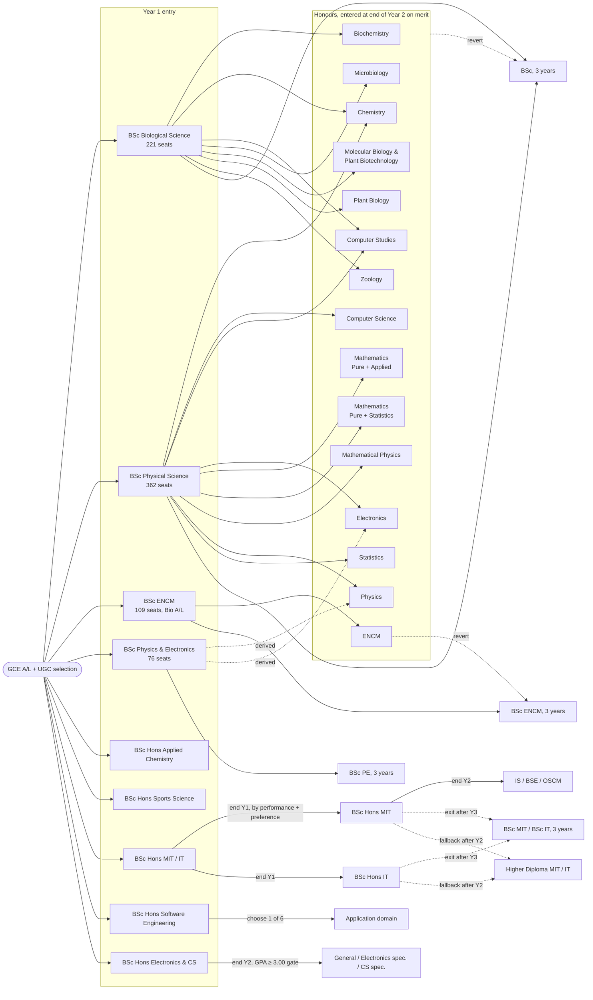

# Faculty of Science (University of Kelaniya): Degree Pathways Map

Source: *Student Handbook 2023/2024, Faculty of Science* ([Documents/Student Handbook 2023-2024.pdf](../Documents/Student%20Handbook%202023-2024.pdf)).
Page numbers below (`p.N`) are the printed handbook page numbers. Machine-readable version: [degree-programmes.json](degree-programmes.json).

> Items marked **(derived)** are not stated as a sentence in the handbook. They were worked out from the course-structure tables. For example, "BS combination 4 can lead to Microbiology Hons" is derived by matching the subjects in combination 4 against the Microbiology Hons entry rule.

---

## 1. The big picture

- **5 BSc degrees** (3 years, SLQF 5, ≥ 90 credits)
- **20 BSc Honours degrees** (4 years, SLQF 6, ≥ 120 credits)
- Two-semester academic year; each semester is 15 weeks of teaching, then 2 weeks of study leave, then 3–4 weeks of exams.
- **8 departments:** Chemistry, Industrial Management, Mathematics, Microbiology, Physics & Electronics, Plant & Molecular Biology, Statistics & Computer Science, Zoology & Environmental Management.
- **2 units:** Software Engineering Teaching Unit, Sports & Exercise Science Unit.

There are **two ways into an Honours degree**:

| Route | Programmes |
|---|---|
| **Direct intake** (selected by the UGC straight into the Honours programme from Year 1) | Applied Chemistry (APCH), Sports Science (BSSS), Management & IT (MIT) / IT, Software Engineering (SENG), Electronics & Computer Science (BECS) |
| **Merit intake at end of Year 2** (from the BSc, BSc ENCM or BSc PE programmes) | Biochemistry, Chemistry, Computer Science, Computer Studies, Electronics, ENCM, Mathematics (2 variants), Mathematical Physics, Microbiology, Molecular Biology & Plant Biotechnology, Physics, Plant Biology, Statistics, Zoology |

### Overall map



---

## 2. Year 1 entry streams

| Stream | UGC intake | When subjects are allocated | Subject caps |
|---|---|---|---|
| **Biological Science (BS)** | 221 (incl. additional intake) | Start of **Semester 2, Year 1**, based on Semester 1 exam results (only when demand exceeds capacity) | Biochemistry 60, Computer Studies 25, Microbiology 60 |
| **Physical Science (PS)** | 362 | Start of **Year 1** (when demand exceeds capacity) | Computer Science 150, Computer Studies 25, Electronics 40, Statistics 125 |
| **ENCM** | 109, from Bio A/L stream, in a separate UGC window | Fixed programme | none |
| **Physics & Electronics (PE)** | 76 | Fixed, 2 paths | none |
| Direct-intake Hons (APCH, BSSS, MIT/IT, SENG, BECS) | Not stated in handbook | Fixed or branching (see §5) | none |

**BS rule:** Every BS student follows the stream-compulsory units in Year 1 Semester 1. Anyone may take COST 11012. To take **Computer Studies as a subject**, you must take **COST 11012 + COST 11023 in Y1 S1** (p.6).

---

## 3. BSc (3-year) subject combinations

### 3.1 Biological Science: 8 combinations (p.37–39)

Every BS combination also includes the **BIOL stream units** (BIOL 11512, 11522, 11532, 11552) and **Chemistry** in Years 1–2. In Year 3 only CHEM 31731 is compulsory; the other Year 3 Chemistry units are optional.

| # | Subjects (besides CHEM + BIOL) | Can lead to Hons in **(derived)** |
|---|---|---|
| 1 | Plant Biology + Zoology | Plant Biology, MBBT, Zoology, Chemistry |
| 2 | Computer Studies + Plant Biology | Computer Studies, Plant Biology, MBBT, Chemistry |
| 3 | Computer Studies + Zoology | Computer Studies, Zoology, Chemistry |
| 4 | Microbiology + Plant Biology | Microbiology, Plant Biology, MBBT, Chemistry |
| 5 | Microbiology + Zoology | Microbiology, Zoology, Chemistry |
| 6 | Biochemistry + Microbiology | Biochemistry, Microbiology, Chemistry |
| 7 | Biochemistry + Plant Biology | Biochemistry, Plant Biology, MBBT, Chemistry |
| 8 | Biochemistry + Zoology | Biochemistry, Zoology, Chemistry |

Note: to claim **Zoology** as a BSc subject, you need at least 7 credits from Year 3 ZOOL optional units, with at least 3 credits in each semester (p.39).

### 3.2 Physical Science: 10 combinations (p.40–42)

| # | Subjects | Can lead to Hons in **(derived)** |
|---|---|---|
| 1 | Applied Maths + Physics + Pure Maths | Mathematics (PM+AM), **Mathematical Physics** (the only combination with all three of its required subjects), Physics |
| 2 | Computer Science + Physics + Pure Maths | Computer Science, Physics |
| 3 | Electronics + Physics + Pure Maths | Electronics, Physics |
| 4 | Applied Maths + Computer Science + Pure Maths | Computer Science, Mathematics (PM+AM) |
| 5 | Computer Science + Pure Maths + Statistics | Computer Science, Statistics, Mathematics (PM+Stat) |
| 6 | Chemistry + Computer Science + Pure Maths | Chemistry, Computer Science |
| 7 | Applied Maths + Chemistry + Pure Maths | Chemistry, Mathematics (PM+AM) |
| 8 | Computer Studies + Electronics + Physics *(the only combination without Pure Maths)* | Computer Studies, Electronics, Physics |
| 9 | Applied Maths + Pure Maths + Statistics | Mathematics (PM+AM or PM+Stat), Statistics |
| 10 | Chemistry + Computer Studies + Pure Maths | Chemistry, Computer Studies |

### 3.3 Physics & Electronics (PE): 2 paths (p.43–44)

| Path | Subjects |
|---|---|
| Path 1 | Physics + Electronics + Mathematics (PMAT and AMAT units) |
| Path 2 | Physics + Electronics + Computer Studies (plus some PMAT units) |

### 3.4 ENCM: single fixed structure (p.45)

ENCM units, plus Chemistry, Plant Biology, Microbiology and Zoology units. You must take at least one Year 3 optional unit (ENCM 32782 or ENCM 32792).

---

## 4. Honours entry at end of Year 2 (p.10–13)

### 4.1 The standard gate (applies to every subject below)

1. **GPA ≥ 3.00**
2. **C or better in all compulsory course units of the subject** in Years 1 and 2
3. **No more than 8 credits** of D / D+ / C− grades across *all* Year 1–2 units
4. **No E grades** in any Year 1–2 unit

Other conditions:

- Departments set the maximum intake each year. Selection criteria "may be varied at the discretion of the Department".
- You need approval from the Head(s) of Department for your course units before enrolling.
- Year 4 includes a research or study project with a supervisor.

### 4.2 Subject-specific extras

| Honours degree | Extra requirement beyond the standard gate | Hons course column **(derived)** |
|---|---|---|
| **Biochemistry** | Compulsory units must include BIOL 11532. Also **B or better for 2 more credits** from: CHEM 11622, 11631, 12661, 21672, 22712, 22721 | Bio col 8 |
| **Chemistry** | none | Bio col 2 / Phys col 9 |
| **Computer Science** | Department caps numbers | Phys col 7 |
| **Computer Studies** | Department caps numbers. COST 31133 is compulsory only for Bio-stream entrants | Bio col 7 / Phys col 8 |
| **Electronics** | Department caps numbers | Phys col 10 |
| **ENCM** | Compulsory units relevant to the specialisation at C+. Also **B or better in ≥ 40 credits** of ENCM, CHEM, MIBI, PLBL and ZOOL compulsory units from Y1–2 | Bio col 3 |
| **Mathematical Physics** | Must have taken **Applied Maths, Physics and Pure Maths** in Y1–2. Department caps numbers | Phys col 3 |
| **Mathematics (Pure + Applied)** | C+ in PMAT compulsory units (20 credits) and AMAT compulsory units (18 credits) | Phys col 1 |
| **Mathematics (Pure + Statistics)** | C+ in PMAT compulsory units (20 credits) and STAT compulsory units (20 credits) | Phys col 2 |
| **Microbiology** | C+ in MIBI compulsory units and BIOL 11512, totalling ≥ 20 credits | Bio col 4 |
| **Molecular Biology & Plant Biotechnology** | C+ in Plant Biology compulsory units. Also **B or better** in those units + BIOL 11512, totalling 22 credits, **and B+ or better** in BIOL 11522 Genetics and PLBL 21532 Fundamentals of Molecular Biology | Bio col 5 |
| **Physics** | Department caps numbers. There are two Year 3–4 structures: for students who did not take Electronics (they take PHYS 32551 and 32562) and for those who did | Phys cols 4 and 5 |
| **Plant Biology** | **B or better** in Plant Biology compulsory units + BIOL 11512 + BIOL 11522, totalling 22 credits | Bio col 1 |
| **Statistics** | Department caps numbers | Phys col 6 |
| **Zoology** | **B or better** in ZOOL compulsory units + BIOL 11552, 11512 and 11522, totalling ≥ 20 credits | Bio col 6 |

### 4.3 Honours course-structure columns (p.47–50)

- **Biological Hons (8 columns):** 1 Plant Biology · 2 Chemistry · 3 ENCM · 4 Microbiology · 5 MBBT · 6 Zoology · 7 Computer Studies · 8 Biochemistry
- **Physical Hons (10 columns):** 1 Maths (PM+AM) · 2 Maths (PM+Stat) · 3 Mathematical Physics · 4 Physics (no Electronics background) · 5 Physics (Electronics background) · 6 Statistics · 7 Computer Science · 8 Computer Studies · 9 Chemistry · 10 Electronics
- Maths (PM+AM) students take AMAT 43976 **or** PMAT 43976 (the research project). Mathematical Physics students take AMAT 43976 **or** PHYS 43888.

---

## 5. Direct-intake Honours programmes and their internal branches

### 5.1 MIT / IT (Department of Industrial Management) (p.7–8, 51–52)

```
Year 1 (common) ──end Y1: performance + preference──► BSc Hons IT  ──────────────────────────► (Y2–Y4)
                                                   └► BSc Hons MIT ──end Y2──► specialise in:
                                                                                • Information Systems (IS)
                                                                                • Business Systems Engineering (BSE)
                                                                                • Operations & Supply Chain Mgmt (OSCM)
```

Ways to leave the programme early:

- **End of Year 3:** you can request the 3-year **BSc (MIT)** or **BSc (IT)** (§6.4).
- **End of Year 2:** the fallback award is the **Higher Diploma in MIT / IT** (§6.4).

Other notes:

- The final-year project is either MGTE 43216 or INTE 43216.
- MIT/IT students may take any Industrial Management unit, and auxiliary units from other faculties.

### 5.2 Software Engineering (SENG Teaching Unit) (p.8–9, 53–54)

- Fixed core, a **6-month internship**, and a **1-year research component**.
- Choose **one of 6 application domains** (you need at least 9 credits in it):
  - AD1 Net Centric
  - AD2 Mobile Computing
  - AD3 Data Science & Engineering
  - AD4 Health Informatics
  - AD5 Digital Gaming & Animation
  - AD6 Business Engineering

### 5.3 Electronics & Computer Science (BECS) (p.9–10, 57–58)

- Years 1–2 are common. At the **end of Year 2** you go into one of three Year 3–4 pathways:
  1. **Electronics & Computer Science** (general)
  2. **Specialisation in Electronics**
  3. **Specialisation in Computer Science**
- **Gate to specialise:**
  - GPA ≥ 3.00 in the relevant subject's compulsory modules from Y1–2. That is 24 credits for Electronics and 23 credits for CS.
  - C or better in all of those modules.
  - No more than 8 credits of D / D+ / C− across Y1–2.
  - No E grades in Y1–2.
  - Departments cap numbers each year.

### 5.4 Applied Chemistry (APCH) (p.6, 55–56)

Fixed path in every year: APCH and CHEM core, plus ELEC, ENCM, MACS and MIBI units.

### 5.5 Sports Science (BSSS) (p.7, 59–60)

- Starts with a **4-week foundation programme** (BSSS 015xx: English, Biology, Physics, Maths, Chemistry, Computer Science). Completing it earns a Certificate of Completion.
- The foundation programme is designed for students whose A/L subjects differ from the usual Sports Science background.
- After that, the path is fixed for all 4 years.

---

## 6. Degree award and class requirements (p.17–35)

### 6.1 Grading (p.16)

| Marks | 85–100 | 70–84 | 65–69 | 60–64 | 55–59 | 50–54 | 45–49 | 40–44 | 35–39 | 30–34 | 25–29 | 0–24 |
|---|---|---|---|---|---|---|---|---|---|---|---|---|
| Grade | A+ | A | A− | B+ | B | B− | C+ | C | C− | D+ | D | E |
| Points | 4.0 | 4.0 | 3.7 | 3.3 | 3.0 | 2.7 | 2.3 | 2.0 | 1.7 | 1.3 | 1.0 | 0.0 |

- **Repeat:** if you got below C, you may re-sit the next year. The best grade you can get on a re-sit is **C**, and you keep the old grade if the new one is lower.
- **Absent:** an absent result counts as 0 grade points.
- **Lab attendance:** 50–79% caps your grade at C, and below 50% caps it at D.
- Up to 10% of lecture marks can come from attendance.

### 6.2 Minimum award requirements

| Degree | Credits (D or better) | C-or-better credits | Other key rules | Min GPA | Max time |
|---|---|---|---|---|---|
| **BSc** | ≥ 60 in Y1–2, ≥ 90 total, ≥ 30 per year | ≥ 72, of which ≥ 48 from **two subjects** (≥ 24 each, at least one with a practical component), + 18 more at D+ | none | 2.00 | 5 yrs |
| **BSc ENCM** | same as BSc | ≥ 72, of which ≥ 48 from compulsory units, + 18 more at D+ | ≤ 6 credits of D/D+/C− in **each** area: (ENCM) · (PLBL+MIBI+ZOOL) · (CHEM) | 2.00 | 5 yrs |
| **BSc PE** | same as BSc | ≥ 72, of which ≥ 48 from **PHYS and ELEC** (≥ 24 each) | none | 2.00 | 5 yrs |
| **BSc Hons** (subject) | Y1–2: ≥ 30 per year incl. ≥ 10 in specialisation subject(s), ≥ 60 total. Y3–4: ≥ 66 incl. ≥ 48 Level-4 in specialisation. **≥ 126 total** | ≥ 100 (≥ 40 at Level 4) + 26 more at D+ | No E in any specialisation unit | 2.00 | 6 yrs |
| **BSc Hons ENCM** | as Hons, incl. all compulsory units | ≥ 100 (≥ 40 at Level 4 incl. research project) + 26 more | ≤ 6 credits of D/D+/C− per subject area (3 areas). **No E in any unit** | 2.00 | 6 yrs |
| **BSc Hons MIT / IT** | ≥ 72 in Y1–2 incl. all compulsory; **≥ 132 total**; ≥ 30 in each of Y3 and Y4 | ≥ 105 | C+ in MGTE/INTE 43216, INTE 31356, GNCT 32216, GNCT 13212, GNCT 23212 | 2.00 | 6 yrs |
| **BSc MIT / IT** (exit after Y3) | ≥ 72 in Y1–2; ≥ 102 total; ≥ 30 in Y3 | ≥ 85, and C+ in compulsory units ≥ 70 credits (MIT) or ≥ 68 credits (IT) | C+ in INTE 31356, GNCT 32216, GNCT 13212, GNCT 23212 | 2.00 | 5 yrs |
| **Higher Diploma MIT / IT** (fallback after Y2) | ≥ 72 in Y1–2 incl. all compulsory | ≥ 60 | C+ in GNCT 13212, GNCT 23212 | 2.00 | 6 yrs |
| **BSc Hons SENG** | ≥ 120 incl. all compulsory; ≥ 30 per year; ≥ 9 in one application domain | ≥ 104; and ≥ 90 C+ credits in compulsory + domain units | C+ in SENG 31242, 34213, 32216, 43216; pass GNCT 13212, 23212 | 2.00 | 6 yrs |
| **BSc Hons BECS** | ≥ 30 per SLQF level (3–6) | ≥ 104 + 16 more at D+ | none | 2.00 | 6 yrs |
| **BSc Hons APCH** | ≥ 60 in Y1–2; ≥ 120 total; ≥ 30 per year | ≥ 96, and ≥ 84 C+ credits in compulsory units | none | 2.00 | 6 yrs |
| **BSc Hons BSSS** | ≥ 30 per SLQF level (3–6) | ≥ 104 + 16 more at D+ | none | 2.00 | 6 yrs |

### 6.3 Classes

Classes must be earned within the minimum time: **3 consecutive years** for BSc degrees and **4 consecutive years** for Hons degrees.

| Degree | First Class | Second Upper | Second Lower |
|---|---|---|---|
| BSc / BSc ENCM / BSc PE | GPA ≥ 3.70 · C+ in ≥ 90 cr · A in ≥ ½ credits | GPA ≥ 3.30 · C+ in ≥ 80 cr · B in ≥ ½ | GPA ≥ 3.00 · C+ in ≥ 80 cr · B in ≥ ½ |
| BSc Hons (subject) / Hons ENCM | GPA ≥ 3.70 · C+ in ≥ 126 cr (incl. all specialisation) · A in ≥ ½ of L4 spec. credits and ≥ ½ of L3+L4 spec. credits | GPA ≥ 3.30 · C+ in ≥ 116 · B in ≥ ½ (L4 and L3+4) | GPA ≥ 3.00 · same as 2U |
| Hons MIT / IT | GPA ≥ 3.70 · C+ in all GPA units · A in ≥ ½ | GPA ≥ 3.30 · C+ in ≥ 117 · B in ≥ ½ | GPA ≥ 3.00 · C+ in ≥ 117 · B in ≥ ½ (overall and compulsory) |
| BSc MIT / IT (3-yr exit) | GPA ≥ 3.70 · C+ in all · A in ≥ ½ | GPA ≥ 3.30 · C+ in ≥ 99 · B in ≥ ½ | GPA ≥ 3.00 · C+ in ≥ 99 · B in ≥ ½ |
| Hons SENG | GPA ≥ 3.70 · C+ in all · A in ≥ ½ of compulsory credits and ≥ ½ overall | GPA ≥ 3.30 · C+ in ≥ 110 · B in ≥ ½ (compulsory and overall) | GPA ≥ 3.00 · same as 2U |
| Hons BECS | GPA ≥ 3.70 · C+ in ≥ 120 (≥ 30 per SLQF level) · A in ≥ 50% | GPA ≥ 3.30 · C+ in ≥ 112 + 8 at D+ · B in ≥ 50% | GPA ≥ 3.00 · same as 2U |
| Hons APCH | GPA ≥ 3.70 · C+ in ≥ 120 · A in ≥ ½ of L4 credits | GPA ≥ 3.30 · C+ in ≥ 110 · B in ≥ ½ of L4 | GPA ≥ 3.00 · same as 2U |
| Hons BSSS | GPA ≥ 3.70 · C+ in ≥ 120 · A in ≥ 50% **at each SLQF level** | GPA ≥ 3.30 · C+ in ≥ 112 + 8 · B in ≥ 50% at each level | GPA ≥ 3.00 · same as 2U |

**Borderline notes:** a student who misses a class only because of a few weak grades may be considered by the Board of Examiners for the next class down.

| Programme | Weak grades allowed under this note |
|---|---|
| Hons (subject), Hons ENCM | ≤ 6 credits of D/D+/C− in Year 4 |
| APCH | ≤ 6 credits of D/D+/C− in Levels 3–4 |
| MIT / IT | ≤ 4 credits of D/D+/C− in compulsory units |
| SENG, First Class | ≤ 4 credits of D+ |
| SENG, Second Upper | ≤ 4 credits of D in compulsory units |

### 6.4 Exit, fallback and revert options

| From | Option | When to request |
|---|---|---|
| Any end-of-Y2 Honours | Revert to **BSc** (graded on Years 1–3 only) | During Year 4, or within 14 days of the final Year 4 results |
| Hons ENCM | Revert to **BSc ENCM** | Same |
| Hons BECS | Revert to **BSc in Electronics & Computer Science** (graded on Years 1–3) | Same |
| Hons MIT / IT | **BSc (MIT) / BSc (IT)** exit after Year 3 | End of Year 3 |
| Hons MIT / IT | **Higher Diploma in MIT / IT** (fallback) | After Year 2 requirements are met |

---

## 7. Requirements common to all programmes

- **ACLT 11013** (Academic Literacy): you must pass it with at least a C within the first two years. It does not count towards GPA.
- **CMSK** (Complementary Skills): complete at least one unit within the first two years. It does not count towards GPA.
- **Non-GPA Safety Module:** an MCQ quiz at the start of every academic year. You must pass it before you can attend any lab.
- **Units from other faculties:** at most 6 credits in total, and at most 2 credits per semester. The handbook lists Humanities language and culture units, Social Sciences general-education units, and Commerce & Management units on p.102–104.
- **Credit load:** at least 30 credits per academic year.
- **Changing units:** you may add or drop optional or auxiliary units within the first 2 weeks of a semester.
- **Course-code format:** `XXXX abcde`, where `a` is the level, `b` is the semester (1, 2, 3 = both, 4 = either), `cd` is the department's serial number and `e` is the credits.
  - Example: COSC 12043 is a Level 1, Semester 2 unit worth 3 credits.
- **Unit types:** C = Compulsory, O = Optional, A = Auxiliary.

---

## 8. Ambiguities and inconsistencies in the handbook

- **GPA scope for end-of-Y2 Honours entry:** the "GPA of 3.00" is not specified as overall or subject-only. BECS specialisation, by contrast, explicitly says it is the GPA of the subject's compulsory modules.
- **"BSc in Electronics & Computer Science":** BECS students can revert to this degree, but it is not in the handbook's list of 5 BSc degrees.
- **Programmes with no Honours entry rules:** §1.5.2 lists 14 Honours subjects and gives 15 rule sets (Mathematics has two). The handbook gives no explicit end-of-Y2 Honours entry rules for **PE graduates** (Physics or Electronics Hons). Their eligibility in this map is derived from the subject content.
- **Typos in the source:** the BSSS award section is numbered "12.15.x" instead of "2.15.x", and the BECS section uses "SLQL" for "SLQF".
- **Missing intake numbers:** the handbook does not give intake numbers for the direct-intake Honours programmes.
